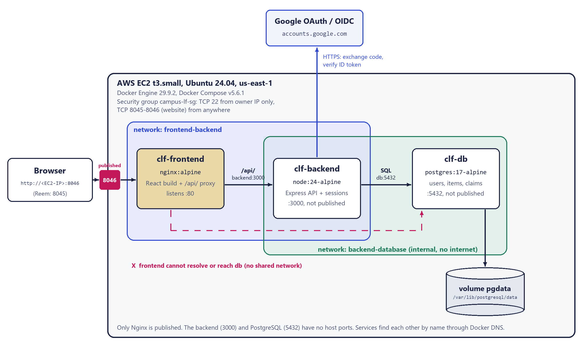

# Campus Lost & Found

A three-tier web app where students report, search and claim lost or found items on campus.
Built for **Cloud Computing Lab 4, Part 2** (Docker Compose multi-tier deployment).

**Team:** Alaa Aladdin (202300746, port **8046**) and Reem Tamer (202300845, port **8045**)

| Tier | Technology | Lab 4 Part 1 used |
|------|------------|-------------------|
| Frontend | React 19 + TypeScript, built with Vite, served by **Nginx** (also the reverse proxy for `/api/`) | HTML/JS + Nginx |
| Backend | **Node.js 24 + Express 5** API, Google OpenID Connect sign-in | Python Flask |
| Database | **PostgreSQL 17** with a named volume | MySQL 8.4 |

All three tiers differ from the lab stack.

---

## Architecture



```
                 Browser
                    |  http://<host>:APP_PORT   (8046 Alaa / 8045 Reem)
                    v
 +------------------------------------------------------------------+
 |  Docker host (EC2 t3.small, Ubuntu 24.04)                          |
 |                                                                   |
 |  [clf-frontend]  nginx:alpine  :80  <-- only published port       |
 |        | serves React build, proxies /api/ -> http://backend:3000 |
 |        |                                                          |
 |   ==== network: frontend-backend ====                             |
 |        |                                                          |
 |  [clf-backend]   node:24-alpine  :3000  (not published)           |
 |        | pg pool -> db:5432                                       |
 |   ==== network: backend-database (internal: no internet) ====     |
 |        |                                                          |
 |  [clf-db]        postgres:17-alpine  :5432  (not published)       |
 |        |                                                          |
 |   (volume) pgdata -> /var/lib/postgresql/data                     |
 +------------------------------------------------------------------+
```

- **Only the frontend publishes a port.** Backend and database have no `ports:` entry.
- The **frontend is not on `backend-database`**, so it cannot resolve or reach `db`.
- `backend-database` is `internal: true`, so the database has no route to the internet either.
- How each tier finds the next: Nginx resolves the service name `backend` through Docker's DNS
  (`127.0.0.11`); the backend connects to `DB_HOST=db`. Service names work because
  containers on the same user-defined network get DNS entries for each other.
- Health checks: `db` uses `pg_isready`, `backend` calls `/api/health` (which runs `SELECT 1`),
  and `frontend` serves `/healthz`. `backend` waits for a healthy `db`; `frontend` waits for a healthy `backend`.
- `restart: unless-stopped` on every service.

## Project structure

```
campus-lost-found/
|-- compose.yaml              three services, two networks, one volume
|-- .env.example              every setting, no real secrets (copy to .env)
|-- .gitignore                keeps .env, keys and node_modules out of Git
|-- README.md
|-- docs/architecture.png     architecture diagram
|-- backend/
|   |-- Dockerfile            node:24-alpine, production deps only, runs as user "node"
|   |-- package.json / package-lock.json
|   |-- src/
|   |   |-- server.js         start-up: wait for DB, run migrations, start API
|   |   |-- app.js            Express app: security headers, sessions, routes
|   |   |-- config.js         reads environment variables
|   |   |-- db.js             pg connection pool, retry, transactions
|   |   |-- migrate.js        applies src/migrations/*.sql once each
|   |   |-- google.js         Google OIDC (code flow + PKCE + state + nonce)
|   |   |-- security.js       session user, auth guard, CSRF check
|   |   |-- validation.js     server-side input rules (zod)
|   |   |-- errors.js         JSON error responses
|   |   |-- migrations/001_schema.sql   tables, constraints, indexes, trigger
|   |   |-- migrations/002_demo_seed.sql  8 clearly-labelled demo listings
|   |   `-- routes/           auth, items, claims, me, meta (health)
|   `-- test/                 24 API tests (node:test + supertest, real PostgreSQL)
|-- frontend/
|   |-- Dockerfile            multi-stage: node build -> nginx:alpine
|   |-- nginx.conf            static files + /api/ reverse proxy + security headers
|   |-- package.json / package-lock.json, vite.config.ts, tsconfig.json, index.html
|   `-- src/                  React pages, components, API client, styles
`-- deploy/
    |-- ec2-setup.sh          installs Docker Engine + Compose on Ubuntu 24.04
    |-- make-env.sh           creates .env with random secrets for a given port
    |-- collect-evidence.sh   prints the lab evidence for one section (secrets hidden)
    `-- run-backend-tests.sh  runs the API tests in Docker against a throwaway PostgreSQL
```

## Database

Three related tables plus the session store:

| Table | Key columns | Rules enforced by PostgreSQL |
|-------|-------------|------------------------------|
| `users` | `google_sub` UNIQUE, `name`, `email` (lower-case), `picture_url` | one row per Google account (`sub`, never email) |
| `items` | `owner_id` -> `users.id`, `title`, `description`, `category`, `item_type`, `location`, `event_date`, `contact_preference`, `status` | CHECK constraints on every enum and length; `resolved_at` set exactly when resolved |
| `claims` | `item_id` -> `items.id`, `claimant_id` -> `users.id`, `message`, `status` | partial UNIQUE index: one *active* claim per user per item; one accepted claim per item; trigger blocks claiming your own or a resolved item |
| `user_sessions` | `sid`, `sess`, `expire` | login sessions (express-session + connect-pg-simple) |

Migrations in `backend/src/migrations` run automatically when the backend starts and are recorded in
`schema_migrations`, so they apply once even on an existing volume.

## Run it

Requirements: Docker Engine with the Compose plugin (`docker compose version`).

```bash
cp .env.example .env            # or: bash deploy/make-env.sh 8046   (random secrets)
# edit .env: set APP_PORT to YOUR port, POSTGRES_PASSWORD, SESSION_SECRET, Google settings
sudo docker compose config --quiet && echo "Compose file is valid"
sudo docker compose up -d --build
sudo docker compose ps          # db (healthy), backend (healthy), frontend (healthy)
```

Open `http://localhost:<APP_PORT>` (on EC2: `http://<public-ip>:<APP_PORT>`).

### Each team member's port

The lab requires host port `8000 + last two digits of your student ID`. Set it in `.env`:

| Member | Student ID | `APP_PORT` | Google redirect URI to register |
|--------|-----------|-----------|----------------------------------|
| Alaa Aladdin | 202300746 | 8046 | `http://localhost:8046/api/auth/google/callback` |
| Reem Tamer | 202300845 | 8045 | `http://localhost:8045/api/auth/google/callback` |

After changing `APP_PORT` (and `GOOGLE_CALLBACK_URL` to match), run `sudo docker compose up -d`.
Only the frontend container is recreated; the data stays.

## Google sign-in setup

The app uses Google's **authorization-code flow with PKCE**. The backend checks `state` (anti-CSRF),
then exchanges the code using the client secret, then verifies the ID token's signature, issuer, audience,
expiry and `nonce`. Only then does it create a server-side session. The client secret never reaches the browser.

1. Open <https://console.cloud.google.com/> and create (or pick) a project.
2. **APIs & Services > OAuth consent screen** (Google Auth Platform): app name *Campus Lost & Found*,
   audience **External**, publishing status **Testing**. Under **Test users** add every account that will
   sign in (both team members' university emails).
3. **Credentials > Create credentials > OAuth client ID > Web application**.
   - Authorized JavaScript origins: not needed for this flow.
   - **Authorized redirect URIs** (exact, including port):
     `http://localhost:8046/api/auth/google/callback`, `http://localhost:8045/api/auth/google/callback`,
     `http://localhost:8080/api/auth/google/callback`
4. Put the client ID and secret into `.env` (never into code or Git):
   ```
   GOOGLE_CLIENT_ID=....apps.googleusercontent.com
   GOOGLE_CLIENT_SECRET=....
   GOOGLE_CALLBACK_URL=http://localhost:8046/api/auth/google/callback
   ALLOWED_EMAIL_DOMAINS=zewailcity.edu.eg
   ```
5. `sudo docker compose up -d` (recreates the backend with the new settings).

**Who can sign in:** only verified emails whose domain is in `ALLOWED_EMAIL_DOMAINS`. The display name
comes from the Google profile; if that is missing or looks like an ID number, it is built from the email
(`s-alaa.aladdin@...` becomes "Alaa Aladdin"). If the university's Google Workspace blocks unverified
third-party apps, sign-in shows "Access blocked"; that is a university admin setting, not an app bug.
Clear `ALLOWED_EMAIL_DOMAINS` to allow any Google account for testing.

**Why `localhost` on EC2:** Google only accepts redirect URIs on `localhost` or on an HTTPS domain, never a
bare IP like `http://32.x.x.x:8046`. On EC2 we therefore sign in through an SSH tunnel, which makes the
remote site appear on your own `localhost`:

```bash
ssh -i ~/.ssh/campus-lf-key.pem -L 8046:localhost:8046 ubuntu@<EC2_PUBLIC_IP>
# keep it open, then browse http://localhost:8046 and click "Sign in with Google"
```

Browsing and searching work on the public URL without signing in. A real HTTPS domain would remove the tunnel step.

Without Google credentials the app still starts: browsing works and the sign-in button reads "Sign-in not set up".

## Environment variables (`.env`)

| Variable | Purpose |
|----------|---------|
| `APP_PORT` | Host port mapped to Nginx's port 80 (8046 / 8045) |
| `POSTGRES_DB`, `POSTGRES_USER`, `POSTGRES_PASSWORD` | Database name and credentials, used by both `db` (creates them on first start) and `backend` |
| `SESSION_SECRET` | Signs the session cookie; 32+ random characters |
| `GOOGLE_CLIENT_ID`, `GOOGLE_CLIENT_SECRET` | OAuth client from Google Cloud Console |
| `GOOGLE_CALLBACK_URL` | Must equal a registered redirect URI exactly |
| `ALLOWED_EMAIL_DOMAINS` | Comma-separated allowed domains; empty allows any verified Google account |
| `COOKIE_SECURE` | `true` only when served over HTTPS |

PostgreSQL reads `POSTGRES_*` only when the volume is empty. Changing the password later needs
`ALTER USER` inside the database (or, destroying all data, `docker compose down -v`).

## Security summary

- Identity comes only from the server-side session; any user id in a request body is rejected.
- Session cookie `clf.sid` is `HttpOnly`, `SameSite=Lax`, and `Secure` when `COOKIE_SECURE=true`; the session id is regenerated on login.
- Every state-changing request needs the per-session `X-CSRF-Token` header.
- All SQL uses parameters (`$1`, `$2`, ...). Search text has `%`/`_` escaped.
- Input is validated in the browser and again on the server (lengths, enums, dates).
- Emails are never shown publicly. An owner sees a claimant's email only after accepting the claim; the claimant sees the owner's email only if the owner chose "share my email after I accept".
- Access logs record method, path and status only (no query strings, so OAuth codes are never logged).
- Nginx sends CSP, `X-Frame-Options`, `nosniff` and `Referrer-Policy` headers. The backend runs as the non-root `node` user.

## Tests

```bash
bash deploy/run-backend-tests.sh
```

This starts a throwaway `postgres:17-alpine` container, runs the 24 API tests in a `node:24-alpine`
container against it, and then removes both. It never touches the real stack or its volume. The tests cover health,
seeded demo data, search and filters, the auth guards, OAuth state and domain checks, CSRF, validation,
owner-cannot-claim, duplicate claims (app and database), owner-only accept/resolve, claims on resolved
items, cancel/re-claim and contact privacy.

Frontend type check and build: `cd frontend && npm ci && npm run build`.

## Lab evidence commands

```bash
sudo docker run hello-world && sudo docker --version && sudo docker compose version
sudo docker images
find . -maxdepth 2 -not -path '*/node_modules*' | sort
sudo docker compose ps
curl -s http://localhost:8046/api/health
sudo docker compose exec db psql -U lostfound_app -d lostfound -c "SELECT id, title, item_type, status FROM items ORDER BY id;"
sudo docker network ls
sudo docker network inspect campus-lost-found_frontend-backend campus-lost-found_backend-database
sudo docker compose exec frontend ping -c 1 backend      # works
sudo docker compose exec frontend ping -c 1 db           # bad address 'db'
curl -s --max-time 3 localhost:5432; echo "exit code: $?"   # nothing published
sudo docker volume inspect campus-lost-found_pgdata
sudo docker compose logs --tail=30 frontend backend db
# persistence: add an item, then
sudo docker compose down && sudo docker compose up -d     # never add -v
# failure test
sudo docker compose stop backend    # page shows "service is not answering" banner, /api returns 502
sudo docker compose start backend   # banner disappears within ~5 s
```

## AWS EC2 deployment (what we used)

- Account profile `AWS-UNI`, region `us-east-1`, default VPC, one **t3.small** Ubuntu 24.04 instance,
  20 GB gp3, IMDSv2 required, tagged `Project=CampusLostFound`.
- Security group `campus-lf-sg`: TCP 22 from the owner's IP only; TCP 8045-8046 from anywhere (the website).
  PostgreSQL and the API are never exposed (they have no published ports at all).
- Deploy:
  ```bash
  scp -i ~/.ssh/campus-lf-key.pem deploy/ec2-setup.sh ubuntu@<IP>:~ && ssh -i ~/.ssh/campus-lf-key.pem ubuntu@<IP> bash ec2-setup.sh
  tar --exclude=node_modules --exclude=dist --exclude=.env -czf clf-src.tgz compose.yaml .env.example .gitignore backend frontend deploy
  scp -i ~/.ssh/campus-lf-key.pem clf-src.tgz ubuntu@<IP>:~
  ssh -i ~/.ssh/campus-lf-key.pem ubuntu@<IP>
  mkdir campus-lost-found && tar -xzf clf-src.tgz -C campus-lost-found && cd campus-lost-found
  bash deploy/make-env.sh 8046       # then add the Google values to .env
  sudo docker compose up -d --build
  ```
- Cost: t3.small is about $0.0208/hour plus disk (~$1.60/month) and public IPv4 ($0.005/hour) if not
  covered by the free tier. **Stop or terminate the instance after grading** (EC2 console, or
  `aws ec2 terminate-instances --instance-ids <id> --profile AWS-UNI`). Terminating deletes the disk and its data.

## Troubleshooting

| Symptom | Likely cause | Fix |
|---------|-------------|-----|
| `docker compose up` says `set POSTGRES_PASSWORD in .env` | `.env` missing or incomplete | `cp .env.example .env` and fill it in, or `bash deploy/make-env.sh <port>` |
| `port is already allocated` | Another program uses `APP_PORT` | Pick a free port in `.env`, `docker compose up -d` |
| Page shows "service is not answering" | Backend stopped or crashing | `sudo docker compose ps`, `sudo docker compose logs --tail=100 backend` |
| Page shows "database is unavailable"; `/api/health` returns 503 | `db` stopped or unhealthy | `sudo docker compose logs db`, `sudo docker compose start db` |
| Backend keeps restarting with `password authentication failed` | Password in `.env` changed after the volume was created | Put the old password back, or `ALTER USER` inside the DB |
| Google: `redirect_uri_mismatch` | `GOOGLE_CALLBACK_URL` or browser port differs from the registered URI | Make all three identical (scheme, host, port, path) |
| Google: "Access blocked: app not verified / org policy" | Account not in Test users, or university blocks third-party apps | Add the email as a test user; otherwise test with `ALLOWED_EMAIL_DOMAINS=` and a personal account |
| Sign-in returns "not started from this browser" | Cookie lost between start and callback (e.g. switched between IP and localhost) | Use the same address (`localhost:<port>`) for the whole flow |
| Frontend changes do not appear | Image not rebuilt | `sudo docker compose up -d --build frontend` |
| SSH to EC2 times out | Your public IP changed | Update the SSH rule in `campus-lf-sg` to your new IP |

Golden rule from the lab: read the logs first, and test one tier at a time (db, then backend, then frontend).
